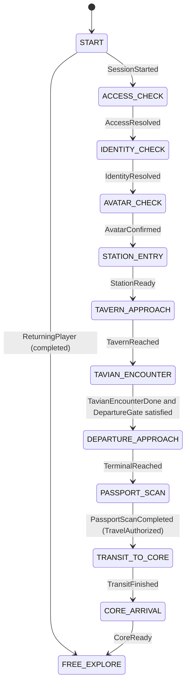

# Phase 3B P5B-2 (Task B) — onboarding redesign and save migration: DESIGN PROPOSAL

**Status: design only.** Nothing in this document is implemented. The existing 11-state machine, the v1 checkpoint schema, the save slots and all gameplay behaviour are unchanged. No canonical content, location id, spawn id, character record or dialogue is invented here; everything canon does not yet supply is marked **TBD (canon)**.
Written for: the people who will approve the redesign and its save migration (product + engineering). Decisions they must make are collected in §19.

## 0. Inputs
**Rulings** (`Phase3B_Canon_Rulings.md`): the station tavern encounter precedes the departure-terminal Passport scan and transit to the Core; Tavian Rell *is* the bartender; the tavern is the **Last Orbit Tavern**; Core manifest authority is unresolved; the redesign + migration need separate approval.
**Narrative requirements (this authorization):** (1) Galactic Space Station → (2) Last Orbit Tavern → (3) Tavian Rell (bartender) → (4) introductory artifact mission involving Aria Vega → (5) departure-terminal Moon Racer Passport scan → (6) authorization to travel to the Core → (7) transit and arrival in the Core. The tavern is neutral territory under Galactic Republic jurisdiction with a limited House Racer security presence. Two more tavern NPCs offer optional quests that can connect to later discoveries (identities and quest content **TBD (canon)**).
**Standing decisions that still bind:** D-1 offline/guest first; D-2 species lock not enforced; D-3 no local→server sync; D-7 interrupted conversations restart from the beginning; D-8 `PASSPORT_HANDOFF` deferred. **D-6 (FREE_EXPLORE on mission acceptance) is superseded by this design (§11)** — flagged for approval.
**Not reviewed:** the Core manifest source documents (v1.2.0 / Library v2.0) were not available/reviewed, so **no Core manifest version is selected** (B-01 stays open).

## 1. Design principles
1. The state machine owns **sequence and persistence only**; story, dialogue, missions and objectives stay in the narrative systems (P5A/P5B). Canon changes should change data, not the spine.
2. Every canon-dependent id (locations, spawns, NPCs, missions, cinematics) is data supplied by an approved bundle, never a constant.
3. A location is a first-class concept: a safe spawn belongs to a *location*, and resume must put the player in the right one.
4. Gates are explicit flags with explicit owners. **Accepted ≠ completed**, and a Passport *scan* ≠ online authentication.
5. Migration never loses progress, never replays a completed mission or one-time effect, never overwrites a save in place, and always has a safe fallback.
6. Everything is testable with TEST FIXTURE content and primitive dev environments first.

## 2. Proposed state diagram (12 states)

ASCII: `START → ACCESS_CHECK → IDENTITY_CHECK → AVATAR_CHECK → STATION_ENTRY → TAVERN_APPROACH → TAVIAN_ENCOUNTER → DEPARTURE_APPROACH → PASSPORT_SCAN → TRANSIT_TO_CORE → CORE_ARRIVAL → FREE_EXPLORE` (and `START → FREE_EXPLORE` for completed players).
State names are proposals; final names follow canon naming (**TBD (canon)**).
**Not states (run alongside, in the narrative layer):** optional tavern NPC conversations/quests (§9), the artifact mission (§8), the objective tracker.

## 3. State transition table
| # | State | Purpose | Entry condition | Work | Exit event | Checkpoint (new flags) | Blocked when | Canon deps |
|---|---|---|---|---|---|---|---|---|
| 0 | START | route new vs returning | process start | choose path | `SessionStarted` / `ReturningPlayer` | — | — | — |
| 1 | ACCESS_CHECK | local prerequisites | START | writable save location | `AccessResolved` | `bAccessResolved` | save location unusable | — |
| 2 | IDENTITY_CHECK | resolve identity mode (v1 `PASSPORT_CHECK`, headless) | access done | `IMRPassportService::GetStatus()`; offline guest in v1 | `IdentityResolved` | `bIdentityResolved`, `IdentityMode` | service reports non-offline/failed → `ContinueOffline()` (as today) | — |
| 3 | AVATAR_CHECK | valid confirmed avatar | identity done | load avatar; open Creator if missing | `AvatarConfirmed` | `bAvatarConfirmed`, `AvatarRef` | Creator unavailable | — (§6) |
| 4 | STATION_ENTRY | place the player on the station | avatar done | load station location; spawn at station arrival spawn; optional opening cinematic if canon has one | `StationReady` | `bStationEntered`, station safe spawn | station location/spawn unavailable | station location id, spawn id, optional cinematic (**TBD**) |
| 5 | TAVERN_APPROACH | get the player to the Last Orbit Tavern | station ready | objective + trigger (auto-satisfied if the spawn is inside the tavern) | `TavernReached` | `bTavernReached` | objective unavailable | tavern location/trigger id (**TBD**) |
| 6 | TAVIAN_ENCOUNTER | Tavian Rell (bartender): conversation + artifact-mission offer | tavern reached | interact → dialogue graph; mission offered/accepted by dialogue effects | `TavianEncounterDone` | `bTavianEncounterDone` | NPC/dialogue unavailable; conversation interrupted → retry restarts (D-7) | Tavian record + graph, mission record (**TBD**) |
| 7 | DEPARTURE_APPROACH | free time in the station; reach the departure terminal | encounter done AND `DepartureGate` satisfied (§8) | objective + trigger; optional NPCs available throughout | `TerminalReached` | `bDepartureReached` | gate not satisfied (shows why) | departure terminal id/trigger (**TBD**) |
| 8 | PASSPORT_SCAN | in-fiction Moon Racer Passport scan | terminal reached | `IMRPassportScanService::PerformScan` (§7) | `PassportScanCompleted` | `PassportScanResult`, `bTravelAuthorized` | scan service unavailable/denied → retry | scan scene content, authorization rule (**TBD**) |
| 9 | TRANSIT_TO_CORE | depart the station | travel authorized | optional transit cinematic (skippable) → load Core | `TransitFinished` | `bTransitSeen` or `bTransitSkippedUnavailable` | Core location unavailable (player stays in the station, retryable) | transit cinematic, Core location id (**TBD**, B-01) |
| 10 | CORE_ARRIVAL | arrive and spawn in the Core | transit finished | spawn at the approved Core arrival spawn | `CoreReady` | `bCoreArrived`, Core safe spawn | spawn fails (fallback to the default Core arrival spawn once, as today) | Core arrival spawn id (**TBD**) |
| 11 | FREE_EXPLORE | normal play | §11 conditions | none | terminal | `bOnboardingCompleted` | — | — |

## 4. Mapping from each existing state to the proposed design
| Existing (v1) | Proposed (v2) | Notes |
|---|---|---|
| START | START | unchanged |
| ACCESS_CHECK | ACCESS_CHECK | unchanged |
| PASSPORT_CHECK | **IDENTITY_CHECK** | same headless identity resolution, renamed so it is never confused with the in-fiction scan (state-id string changes → migration maps it) |
| AVATAR_CHECK | AVATAR_CHECK | unchanged position (§6) |
| ARRIVAL_CINEMATIC | **TRANSIT_TO_CORE** (cinematic sub-step); a station opening cinematic is optional | the cinematic concept now belongs to the journey to the Core; v1 `bArrivalSeen` is NOT carried as "transit seen" (§12) |
| CORE_SPAWN | **CORE_ARRIVAL** (Core) + new **STATION_ENTRY** (station) | v1 `bCoreSpawned` does not satisfy STATION_ENTRY |
| FIRST_OBJECTIVE | **TAVERN_APPROACH** (+ **DEPARTURE_APPROACH** as the second objective) | location-aware objectives |
| TAVIAN_DIALOGUE | **TAVIAN_ENCOUNTER** | now before the Core |
| BARTENDER_HANDOFF | merged into **TAVIAN_ENCOUNTER** | Tavian *is* the bartender; no separate bartender character; "hand-off" = the encounter ending with the onward objective |
| FIRST_MISSION | no standalone state; offer/acceptance happens inside **TAVIAN_ENCOUNTER** (narrative effects) | D-6 superseded (§11) |
| FREE_EXPLORE | FREE_EXPLORE | entry conditions change (§11) |

## 5. Interfaces (additive only)
Existing seams already carry `LocationId` (`IMRWorldService`, `IMRSpawnService`). Additions (non-breaking, defaulted like the P5A dialogue additions): `IMRQuestService::GetStatus(QuestId)` (needed for the gate; the mission itself stays in the narrative save); `IMRPassportScanService` (§7); a per-location safe-spawn store in the record (§12). Fixtures implement them for tests.

## 6. Avatar Creator placement (explicit)
**Recommendation: unchanged — AVATAR_CHECK stays before STATION_ENTRY**, because the avatar must exist to spawn on the station and every existing avatar save/test keeps working with no change. The Creator opens exactly as today and its saved event still drives the transition.
**Alternative (needs canon):** an in-fiction avatar moment at the terminal (e.g. as part of the Passport scan). That would move AVATAR_CHECK after DEPARTURE_APPROACH and require a placeholder avatar for the station — rejected as default because nothing in the established narrative says it, and it would change avatar-save timing. **Decision D-9.**
Avatar revisit rule (v1: avatar missing/replaced → pass through AVATAR_CHECK again) is kept in the same place; the station scene is entered only with a valid avatar.

## 7. Passport scan and offline-development behaviour
Two distinct things:
- **IDENTITY_CHECK (launch, headless):** establishes `IdentityMode`. v1/offline: `OfflineGuest`. Unchanged.
- **PASSPORT_SCAN (in-fiction, at the terminal):** a player interaction that *consumes* the identity mode and produces `PassportScanResult` and `bTravelAuthorized`.
Proposed `IMRPassportScanService::PerformScan(Done(EMRScanOutcome))`, outcomes: `OfflineGuestSimulated` (dev/offline default), `LinkedVerified` (future, only after an approved online contract — P6), `Denied`, `Unavailable`. 
**Offline-development behaviour:** the scan scene runs; the result is `OfflineGuestSimulated`; the UI labels it clearly as a development/offline simulation; **no network call, no token, no server write (D-3), `OpaqueSubjectId` stays empty, no claim of identity**. `bTravelAuthorized` is granted to offline guests *as a development rule pending canon/decision D-12*.
**A scan is not authentication.** No code path may treat `OfflineGuestSimulated` as a verified Passport. Online behaviour (denied, no-passport → website registration hand-off = D-8's `PASSPORT_HANDOFF`, species-lock D-2) is out of scope and stays deferred.

## 8. Tavian interaction and the artifact-mission handoff
- **TAVIAN_ENCOUNTER** runs the Tavian conversation (his NPC record and graph are canonical content, **TBD**). The conversation completion event ends the state (same contract as today's dialogue states; restart on interruption, D-7).
- The **artifact mission** (involving Aria Vega; definition **TBD**) is offered/accepted by dialogue effects in the *narrative* layer. The onboarding record stores **no mission progress**; the narrative save is authoritative.
- **Accepted is not completed.** The mission is never marked completed by onboarding; completion comes only from its own objective events.
- **Departure gate (data, not code):** `DepartureGate ∈ {None, Offered, Accepted, Completed}` decides what must be true before DEPARTURE_APPROACH → PASSPORT_SCAN can proceed. **The proposal does not pick a value** (canon: does the player need to finish the artifact errand before leaving, or only take it on?) — **Decision D-10.** The gate is evaluated via `IMRQuestService::GetStatus`.
- **Aria Vega's location is not assumed.** The mission's objectives are data; the tracker and objective events are location-independent, so a mission that continues in the Core (or completes on the station) works without onboarding knowing. The transit never auto-completes, fails or advances the mission.
- A player who declines/does not accept: allowed only if `DepartureGate = None` (**D-10**).

## 9. Optional tavern NPC interactions
Two additional tavern NPCs (identities, quests **TBD (canon)**) are **not** states and not gates:
- They are ordinary NPC records with ordinary missions in the narrative layer; the flow data lists their ids so the dev/prod bundles can place them (`StationOptionalNpcIds[]`, count and ids TBD).
- Availability can be gated by facts (`AvailabilityFact`) if canon requires it; offers/acceptances/progress live in the narrative save; none of it is written to the onboarding record.
- "Connect to later discoveries": optional quests emit facts/events through the existing effect system (`SetFact`/`EmitEvent`); later content reads them. Onboarding neither knows nor cares.
- Leaving the station with optional quests Offered/Active is allowed; whether they remain completable depends on whether the station can be revisited (**D-13**) — if not, content must make that clear.
- Neutral-territory/jurisdiction/security-presence details are *setting*, not onboarding logic: no code depends on them; any scripted security behaviour is future content.

## 10. Station-to-Core transit and cinematic handling
TRANSIT_TO_CORE: precondition `bTravelAuthorized`.
1. Optional transit cinematic (`IMRCinematicService`, skippable). Outcomes as today (`Played`, `SkippedByPlayer`, `SkippedAlreadySeen`, `SkippedUnavailable`); unavailable is recorded as *skipped-unavailable* (never "seen") so it can still be shown later. A checkpoint is written when the cinematic edge completes.
2. Load the Core location (`IMRWorldService`). **If it fails, the player stays on the station**, `bTravelAuthorized` is preserved, the state is blocked and retryable.
3. CORE_ARRIVAL: spawn at the approved arrival spawn; on failure fall back **once** to the default Core arrival spawn (existing behaviour); then checkpoint on `CoreReady`.
Interruption: no checkpoint mid-load; resume puts the player back at the **station** terminal (last station safe spawn) with travel still authorized and re-runs TRANSIT_TO_CORE (a cinematic already seen is skipped). Whether the station has a station→Core loading screen vs seamless travel is **TBD (canon/tech)**.

## 11. FREE_EXPLORE entry conditions (and D-6)
All of: access resolved; identity resolved; avatar confirmed and valid; passport scan completed **or** `LegacyGrandfathered` (§12); `bTravelAuthorized`; transit outcome recorded; Core arrived with a valid Core safe spawn.
**Not required:** completing the artifact mission, accepting it (unless `DepartureGate` already required it earlier), or touching optional NPCs.
**D-6 is superseded:** v1 entered FREE_EXPLORE on mission *acceptance*; with the mission now offered at the station before transit, FREE_EXPLORE means "arrived in the Core with authorization". Mission status is independent. Needs approval (**D-6′**).

## 12. Save-version migration strategy
### 12.1 Schema v2 (proposal)
`CurrentProgressVersion` 1 → **2**. Record additions: `bIdentityResolved`(renamed from `bPassportChecked`), `bStationEntered`, `bTavernReached`, `bTavianEncounterDone`, `bDepartureReached`, `PassportScanResult` (enum: NotScanned, OfflineGuestSimulated, LinkedVerified, LegacyGrandfathered, LegacyNotRecorded), `bTravelAuthorized`, `bTransitSeen`, `bTransitSkippedUnavailable`, `bCoreArrived`, `SafeSpawns[]` (per location: `MapId`, `SpawnPointId` — replaces the single `LastSafeSpawn`), `LegacyOrigin` (None / V1Mapped / V1Completed / V1Fallback), and a read-only `LegacyV1` snapshot (v1 state name, flags, safe spawn, content versions) kept for audit. `Validate()`, `IsStateDone`, canonical string/checksum and the resume router are updated for the 12-state spine. The envelope (`MRPG`), A/B slots, generations and the content-version stamp (P5A) are unchanged.
### 12.2 Principles
- Migration is a **pure, deterministic function** `Migrate(v1Record, narrativeEvidence, migrationMap) → {v2Record, outcome, notes}` run **in memory at load**; it never writes.
- **No in-place overwrite:** the first v2 checkpoint goes to the alternate slot (existing A/B writer). Before that write, both v1 slot files are copied once to `<slot>.v1.bak` (never replacing an existing backup; numbered if needed). The v1 data stays in `LegacyV1`.
- **Idempotent:** same input → same output; once a v2 slot is newer it wins; an older build sees v2 as "newer version": ignores it and never overwrites it (verify in R2; see risk R3).
- **Evidence-based, not assumption-based:** progress beyond the verified identity facts is carried only when it can be justified from the v1 flags *and* the narrative save (§12.4). The mapping rules are **data** (`OnboardingMigrationMap`, supplied with approved canon, like the effect-id migrations), not constants.
- **Never claims what did not happen:** `bPassportScan*`, `bTransit*`, `bStationEntered` are never set by migration (except the explicit grandfathered marker for completed players).
### 12.3 Mapping rules (v1 record → v2)
| v1 field | v2 result |
|---|---|
| `bAccessResolved`, `bPassportChecked`, `bAvatarConfirmed`, `AvatarRef`, `IdentityMode`, content versions | carried 1:1 (`bPassportChecked` → `bIdentityResolved`); avatar re-verified against the avatar save at load, as today |
| `bArrivalSeen` / `bArrivalSkippedUnavailable` | kept only in `LegacyV1`; **not** mapped to `bTransitSeen` (a cinematic seen in the old order is not evidence the new transit was seen). The transit cinematic will play once, skippable. |
| `bCoreSpawned`, `LastSafeSpawn` (Core) | kept in `LegacyV1`; `SafeSpawns[]` gets a Core entry **only if** its `MapId` equals the approved Core location id; otherwise unused. Station flags stay false. |
| `bFirstObjectiveDone`, `bTavianIntroduced`, `bBartenderHandoff` | map to `bTavernReached` / `bTavianEncounterDone` **only with narrative evidence** (the approved Tavian dialogue id in `CompletedDialogues`); else not carried (§12.4 cases D/F) |
| `FirstQuestStatus` | mirror only; the narrative save is authoritative. Never causes a re-offer, replay or completion. |
| `bOnboardingCompleted` | policy **D-11** (§12.5) |
### 12.4 Decision table (what a v1 checkpoint becomes)
| Case | v1 progress | v2 outcome |
|---|---|---|
| A | before AVATAR done | carry flags; resume at the first incomplete v2 state (START…AVATAR_CHECK) |
| B | avatar done, nothing further (incl. ARRIVAL_CINEMATIC pending/seen) | resume **STATION_ENTRY**; `LegacyOrigin=V1Mapped` |
| C | CORE_SPAWN done, no objective/dialogue | resume **STATION_ENTRY** (the player has not done any station content); Core safe spawn kept as legacy only |
| D1 | Tavian/bartender flags set **and** narrative evidence of the approved Tavian conversation (+ mission status present) | carry `bTavernReached`/`bTavianEncounterDone`; resume STATION_ENTRY (re-place on the station), then straight to DEPARTURE_APPROACH; nothing replayed; one-time effects and mission statuses untouched |
| D2 | Tavian/bartender flags set, **no** usable evidence | not carried; resume STATION_ENTRY → TAVIAN_ENCOUNTER. Conversation restarts (D-7); the one-time ledger prevents any repeat effect; an accepted/active/completed mission stays as saved; the migration note says this explicitly |
| E | `bOnboardingCompleted` | **D-11**; recommended *grandfather* (below) |
| F | anything inconsistent, unknown state name, failed `Validate()`, narrative evidence required but unavailable | **safe fallback** (§12.6) |
### 12.5 Completed v1 players (D-11)
*Recommended — grandfather:* v2 `FREE_EXPLORE` with `LegacyOrigin=V1Completed`, `PassportScanResult=LegacyGrandfathered`, `bTravelAuthorized=LegacyGrandfathered` (a distinct marker, never a recorded scan), station/transit flags false. They are not forced through the station. Placement: their Core safe spawn if it matches the approved Core location id, else the default Core arrival spawn. *Alternatives:* (B) offer the station sequence as an optional replay with every one-time effect and mission left untouched; (C) reset — **rejected** (violates "preserve progress").
### 12.6 Safe fallback (unmappable checkpoints)
Keep only the verified identity facts (access, identity, avatar if still valid); set `LegacyOrigin=V1Fallback`; embed the full v1 record in `LegacyV1`; back up the v1 files; resume at STATION_ENTRY; set **no** station, scan, transit, arrival or completion flag; never reach FREE_EXPLORE from a fallback; leave the narrative save untouched; log/notice the reason. A fallback is always strictly *earlier* than the truth, never later.
### 12.7 Version chain
`v0 → v1 → v2` (the existing v0 migration still produces v1 first; v2 migration then runs). Newer-than-supported versions are never loaded or overwritten (existing rule). Corrupt/invalid slots fall back to the other slot, then to a fresh record — unchanged.

## 13. Resume and recovery behaviour
General (carried from v1): a state completes only on its exit event; checkpoints are written on completion edges; a blocked state never advances or checkpoints; ACCESS and IDENTITY re-run every launch; the avatar is re-verified; stale service callbacks are ignored.
| Situation | Behaviour |
|---|---|
| resume in STATION_ENTRY…PASSPORT_SCAN | re-load the **station**, respawn at the **station** safe spawn (else the default station arrival spawn once), re-run gating |
| resume after TRANSIT/arrival | respawn at the Core safe spawn |
| resume in TRANSIT_TO_CORE | player is on the station terminal with travel authorized; re-run the sequence (seen cinematic skipped) |
| conversation interrupted | restart from the first node on retry (D-7); one-time effects never repeat |
| passport scan interrupted before completion | scan again (idempotent); no half-authorization is stored |
| station or Core location unavailable | blocked, retryable; **never auto-skip** to a later location (that would bypass the narrative) |
| stuck player | return to the last safe spawn **of the current location** (existing `RecoverToSafeSpawn`, now location-aware) |
| content-version mismatch (P5A) | progress kept; stale safe spawn not trusted → the default spawn of the *current* location |
| gate unsatisfied (`DepartureGate`) | stay in DEPARTURE_APPROACH with a visible reason; no progress lost |
| narrative save missing/corrupt/newer | onboarding still loads; gates that need mission status report "unknown" and stay blocked (never assumed satisfied); the existing narrative-save protections apply |
| both onboarding slots invalid | fresh record (unchanged) |

## 14. Compatibility with existing narrative saves
- The narrative save (`MRNV`, version 1) **needs no migration** and is never rewritten by onboarding migration.
- Read-only evidence the onboarding migration may consult: `CompletedDialogues`, mission statuses, `FiredEffects`, facts. Ids come from the approved migration map (**TBD**), so until canon exists only fixture ids are testable.
- Existing guarantees stay: completed dialogues and the one-time ledger prevent replayed effects; accepted/active/completed missions are never re-offered or reset; version mismatch keeps progress; effect-id migrations carry ledgers.
- New cross-save consistency check at startup (design): onboarding says "Tavian encounter done" but the narrative save lacks the evidence → reported, **no automatic replay and no auto-complete**; the encounter is re-entered only if the departure gate cannot otherwise be evaluated (**D-14**).
- Load order: narrative state first, then onboarding migration (so evidence exists); if it cannot be loaded the migration uses the conservative cases only.

## 15. Canon dependencies and unresolved questions
**Blocked content (all TBD):** station location id and arrival spawn; tavern location/trigger; departure terminal location/trigger; Core location id and arrival spawn (**B-01 Core manifest authority unresolved — no version selected**); Tavian Rell record + dialogue; the artifact mission definition, the artifact, and Aria Vega's record/location; the two optional NPCs and their quests; the scan scene and what "authorization" means in canon; transit/arrival cinematic(s); station and Core environments (B-07).
**Questions:** Q1 Is the avatar created before the station (D-9)? Q2 What must be true to leave the station — offered/accepted/completed (D-10)? Q3 Can offline guests travel (D-12)? Q4 Can the player return to the station after transit (D-13)? Q5 Does the spawn start inside the tavern (skip TAVERN_APPROACH)? Q6 Is there a station opening cinematic? Q7 Where is Aria Vega — station, Core, elsewhere? Q8 Is the in-fiction scan ever the *source* of identity in a future online mode? Q9 Do the optional NPCs gate anything? Q10 Does the transit have a separate loading screen? Q11 What happens to optional quests when the player leaves?

## 16. Implementation risk assessment
| # | Risk | Likelihood | Impact | Mitigation |
|---|---|---|---|---|
| R1 | canon changes after the spine is built | high | high | data-driven ids; spine free of story; gates as data |
| R2 | migration trusts legacy flags and skips content | med | high | evidence-based mapping; fallback is always earlier; matrix §18 |
| R3 | an older build loads a stale v1 slot or overwrites the v2 slot (downgrade) | low (dev only) | high | verify "newer never overwritten" covers slot choice (R2); ship all builds together; `.v1.bak` backups |
| R4 | large test churn (20 onboarding tests, 4 world processes) | certain | med | build v2 behind a dev flag next to v1; port tests; keep v1 until parity |
| R5 | cross-location spawn/safe-spawn bugs | med | high | per-location safe spawns; dedicated tests |
| R6 | narrative/onboarding drift (inconsistent saves) | med | med | read-only evidence; consistency check; never auto-replay |
| R7 | scope creep into canonical content | med | high | fixtures + primitives only until approved bundles exist |
| R8 | passport scan mistaken for authentication | med | high | separate state/flag/enum; UI label; no network/server in this stage |
| R9 | need for station/Core environments (B-07) blocks acceptance | high | med | graybox policy decision; primitive dev maps |
| R10 | interface additions break fixtures | low | low | additive defaults, as in P5A |
| R11 | A/B generation edge cases at the version bump | med | med | first v2 write to the alternate slot + backups; matrix rows M20–M24 |

## 17. Proposed implementation sequence (each step needs its own approval)
- **R0 — decisions + canon intake:** D-9…D-14 (+ D-6′), ids/records as they arrive. *No code.*
- **R1 — spec freeze:** state ids/flags/record schema final; migration map format.
- **R2 — schema v2 + pure migration + tests** (no behaviour change; v1 machine still default): includes the downgrade/overwrite verification and the full matrix §18 on dedicated slots.
- **R3 — additive interfaces + fixtures** (`GetStatus`, passport scan, per-location safe spawns).
- **R4 — v2 state machine behind a dev flag** next to v1; fixture content only; port the automation tests.
- **R5 — dev station/terminal/Core graybox** from primitives (no canonical geography).
- **R6 — objective/tracker/HUD for tavern & terminal; passport scan UI (offline-dev)**.
- **R7 — acceptance:** v1-fixture-save migration soak, world processes, human review.
- **R8 — flip the default after approval; R9 retire v1 after a soak.** Canonical content import is separate (P5B-3+).

## 18. Migration test matrix (to be implemented in R2/R7; dedicated slots only; default-slot guards unchanged)
| ID | Input (v1 checkpoint + narrative evidence) | Expected v2 result |
|---|---|---|
| M01 | no save | fresh v2 record, START path |
| M02–M12 | v1 `CurrentState` = each of the 11 states, flags consistent, fixture content | per §12.4 cases A–E; resume state as tabulated; no flag beyond evidence |
| M13 | v1 AVATAR done but avatar save missing/invalid | avatar revisit path preserved; later flags unaffected |
| M14 | v1 completed, narrative mission NotOffered | D-11 grandfather; FREE_EXPLORE; marker flags; no replay |
| M15 | v1 completed, mission Active / Completed | status unchanged in narrative save; never re-offered/reset |
| M16 | v1 Tavian flags + evidence present | case D1: carried; no dialogue replay; ledger intact |
| M17 | v1 Tavian flags, no evidence / narrative save absent | case D2 / conservative; replay restarts only; effects suppressed |
| M18 | v1 Core safe spawn with fixture Core id vs. non-matching id | Core `SafeSpawns` entry only if ids match |
| M19 | v1 content-version mismatch + migration | both mismatch paths applied; progress kept |
| M20 | v0 legacy save | v0→v1→v2 chain; same result as the equivalent v1 |
| M21 | slots A and B both v1, different generations | newest valid v1 migrated; other slot untouched |
| M22 | slot A v1, slot B corrupt | corrupt ignored/preserved; A migrated |
| M23 | slot A v2 (newer), slot B v1 | v2 wins; no migration; v1 untouched |
| M24 | save version > supported (v3) | not loaded, never overwritten; fresh in memory |
| M25 | migrate twice (same input) | identical v2 records (idempotent) |
| M26 | write interrupted at the first v2 checkpoint | v1 slot and `.v1.bak` intact; relaunch re-migrates identically |
| M27 | `.v1.bak` already exists | not overwritten; numbered backup |
| M28 | inconsistent v1 (done flag without prerequisite, unknown state name, invalid avatar ref) | safe fallback F; no station/scan/transit/arrival/completed flag |
| M29 | narrative save corrupt / newer / missing | migration uses conservative cases; narrative file untouched byte-for-byte |
| M30 | one-time ledger contains the old Tavian effect ids | no effect re-fires after migration and replay |
| M31 | tools: v1 build opens a v2 save | documented manual check: v2 ignored, never overwritten (R3) |
| M32 | default-slot guard | tests refuse default slots; no default file created |
Also required at R7: the existing 20 onboarding automation tests ported to the v2 spine (v1 behaviours preserved where unchanged), the world processes (`partial/resume/returning/corrupt`) on the v2 spine, and a station→Core transit interruption test.

## 19. Decisions requested
D-9 avatar placement (recommend: before the station). D-10 departure gate policy (None/Offered/Accepted/Completed — **no recommendation without canon**). D-11 completed-v1 policy (recommend: grandfather). D-12 may offline guests be authorized to travel (dev rule vs canon). D-13 can the player return to the station. D-14 cross-save inconsistency handling. D-15 station opening cinematic? D-16 spawn inside the tavern? D-6′ approve superseding D-6. D-17 rename `PASSPORT_CHECK` → `IDENTITY_CHECK`.
